# OOTRR tutorial: from install to playing your seed

This guide takes you from nothing to playing a randomized Ocarina of Time remake in the Lichii emulator. It uses Windows screenshots. Mac and Linux work the same way after the install step.

OOTRR is a playtest. Chests, dungeon items and a few optional extras are shuffled, and many of the extras have not been played in the game yet. If something breaks, see the last section.

## What you need

- Windows 10 or 11 (64 bit), or macOS or Linux.
- The Lichii emulator with the game working.
- Your own extracted copy of the game with the 1.1.1 update applied. This guide does not cover extracting it. Ask in the Discord help channel if you need that. You need to end up with a folder that holds the folders `Pack`, `Banc`, `Event` and `System`. That folder is often called `romfs`.
- About 10 minutes.

OOTRR contains no game files and never changes your game folder. It only reads it and writes a new mod folder.

## 1. Install OOTRR

1. Open the [releases page](https://github.com/realazk/ootrr/releases) and download `OOTRR-<version>-windows-x64-setup.exe`. Use the newest version. If you do not want an installer, the `windows-x64.zip` works too (see "Running it without the installer").
2. Optional but wise: check the download against `SHA256SUMS.txt` on the same page. In PowerShell, `Get-FileHash <file>` prints the hash to compare.
3. Run the setup file. The installers are not signed, so Windows SmartScreen may say "Windows protected your PC". Click **More info**, then **Run anyway**. That is expected for a small open source tool.
4. Choose **Install for me only**.

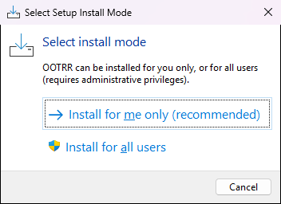

5. Pick a folder, or keep the default. Click Next through the license and information pages.

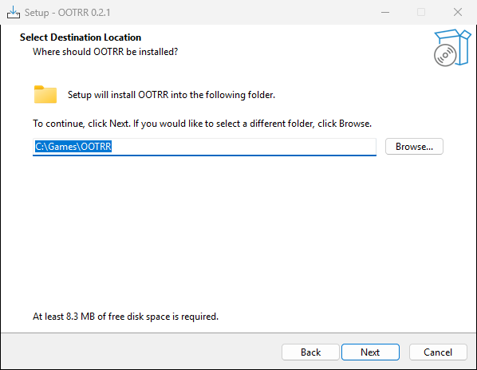

6. On the tasks page you can tick a desktop shortcut and "Add OOTRR to the PATH". You do not need either.

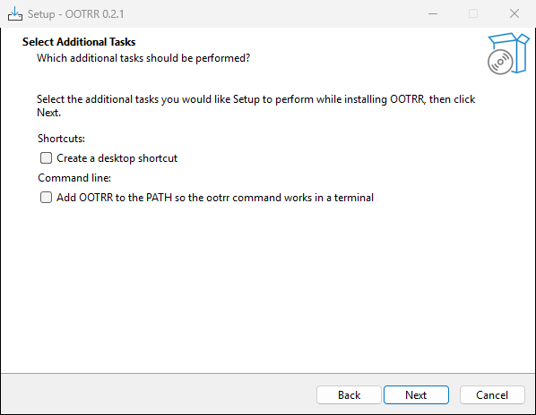

7. Click Install, then Finish.

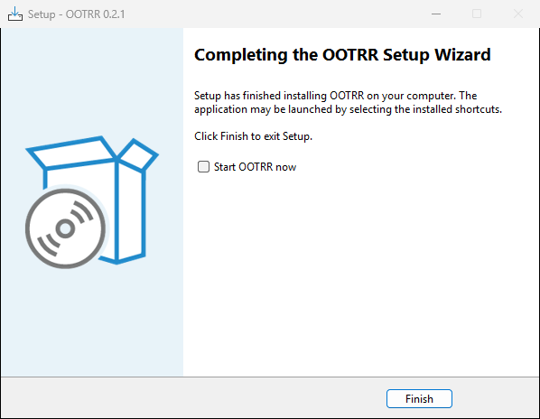

## 2. Start OOTRR

Open the Start menu and click **OOTRR**. A black window opens and your web browser opens the OOTRR page. The black window prints a line like this:

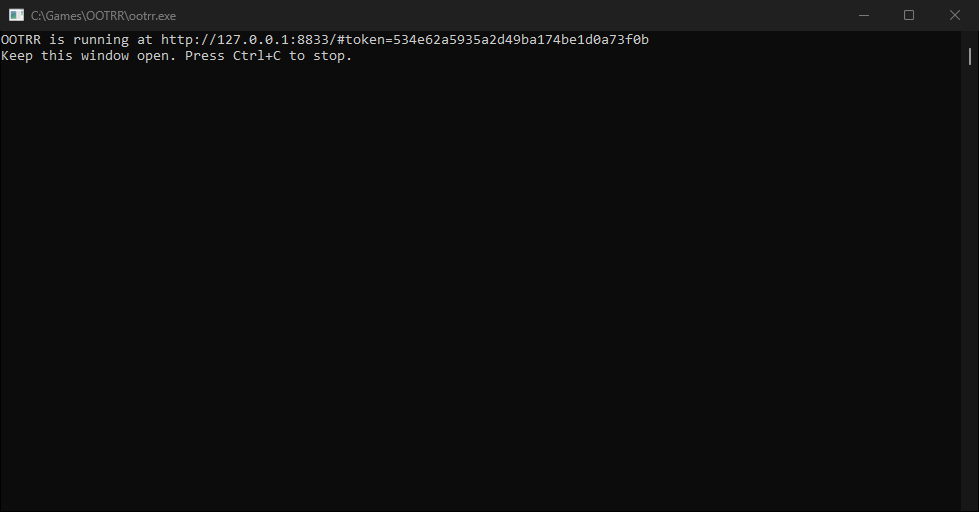

Keep that black window open the whole time you use OOTRR. Closing it stops the program. The page address contains a private token, so do not share a screenshot of it.

If the browser does not open by itself, copy the `http://127.0.0.1...` link from the black window into your browser.

## 3. Setup: tell OOTRR where things are

The page has four steps along the top: Setup, Settings, Generate, Result.

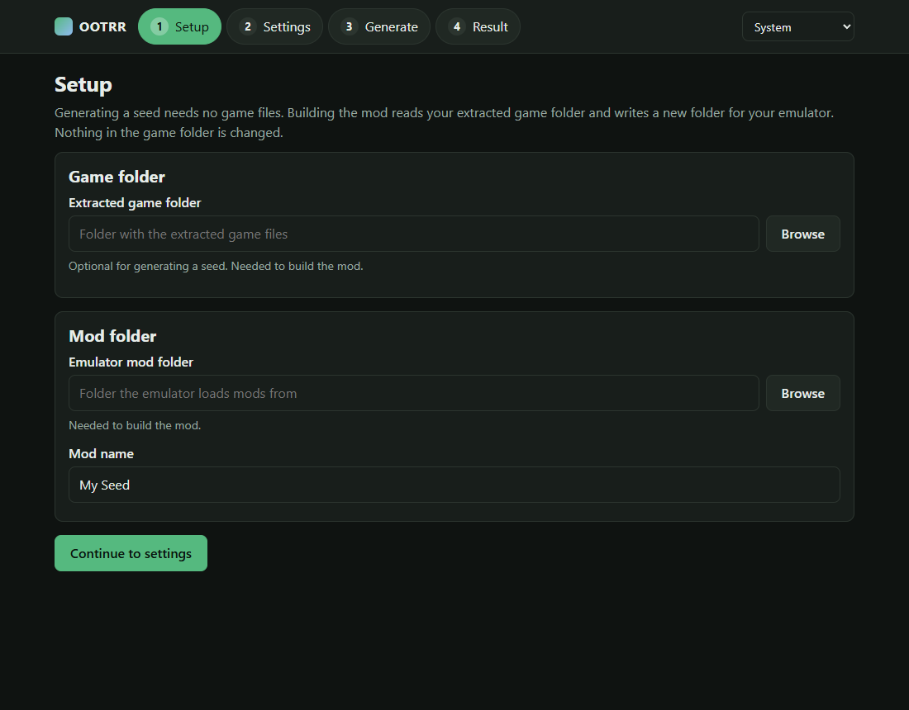

**Game folder.** Click Browse, or paste the path of the folder that holds `Pack`, `Banc`, `Event` and `System`. OOTRR checks it and shows green ticks when it looks right. If it says files of version 1.1.1 are missing, your extraction is the base game without the update. Extract again with the update applied.

**Emulator mod folder.** This is the folder Lichii loads mods from. To find it, in Lichii right click the game and choose **Open Mod Data Location** (screenshot in section 7). A folder named `0400486024DEC000` opens. The folder to enter in OOTRR is the folder that holds `0400486024DEC000`. On a default Lichii install that is `%APPDATA%\eden\load`.

**Mod name.** Any name you like. OOTRR creates the folder `<mod folder>\0400486024DEC000\<mod name>`.

When both boxes show a tick it looks like this:

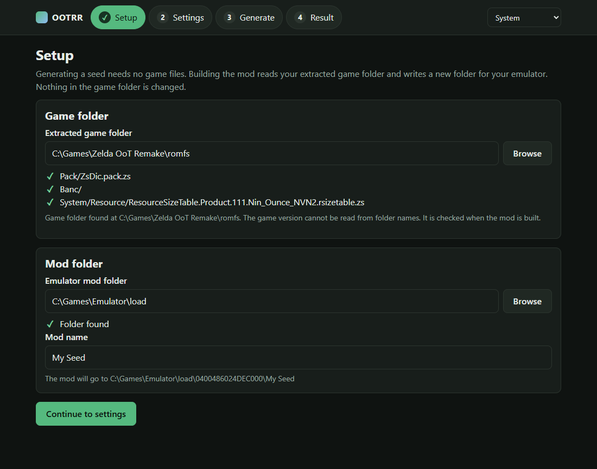

You can skip the game folder and mod folder if you only want to make a seed. They are needed to build the mod.

Click **Continue to settings**.

## 4. Settings

Pick a preset or change settings one by one.

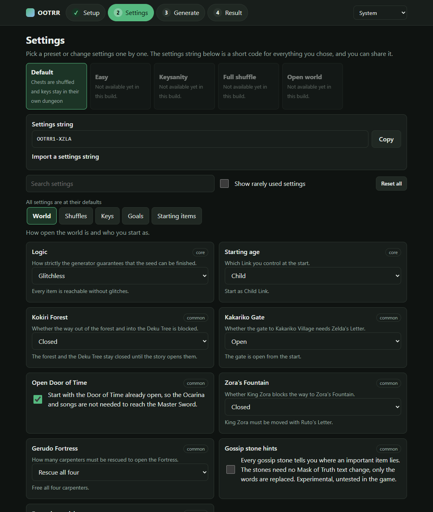

Things to know:

- Only the **Default** preset is available right now. The others are greyed out because they need settings the tool cannot apply yet. Hover over one to see what is missing.
- Many settings are visible but do nothing yet, for example the Rainbow Bridge or Starting age. The build report lists them under "Not applied by this build" so you always know what really changed.
- The settings that do change the game are: which chests are shuffled and how dungeon keys, maps and compasses are placed, boss and NPC rewards, boss heart containers, songs, gossip stone hints, faster item pickups, starting with a Stone or Medallion, and an open Kokiri Forest. Anything marked experimental has not been played in the game yet.
- The short code under the presets is your **settings string**. Share it with friends so they can use the same settings.

When you are happy, click the **Generate** step.

## 5. Generate a seed

Type a seed, or leave it empty for a random one. The same seed with the same settings always gives the same result. Press **Generate seed**.

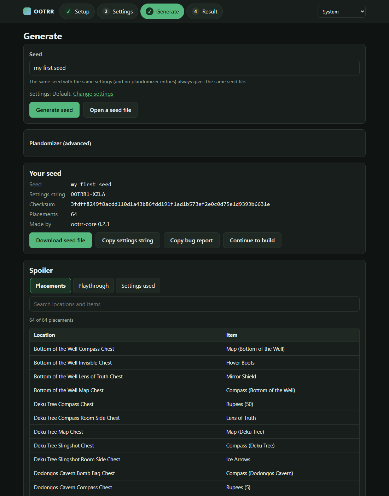

You can see where everything went in the **Spoiler** panel below. Playthrough shows one possible order to beat the game. Do not open it if you want a surprise.

Useful buttons:

- **Download seed file** saves a `.ootrr` file. Keep it, you can open it again later with **Open a seed file**, even on another computer.
- **Copy settings string** and **Copy bug report** are for sharing and for bug reports.
- **Plandomizer (advanced)** lets you force an item into a chosen place, for example to make a seed easier. The seed is only made if it can still be beaten.

Click **Continue to build**.

## 6. Build the mod

On the Result page press **Build mod**. It takes a few seconds.

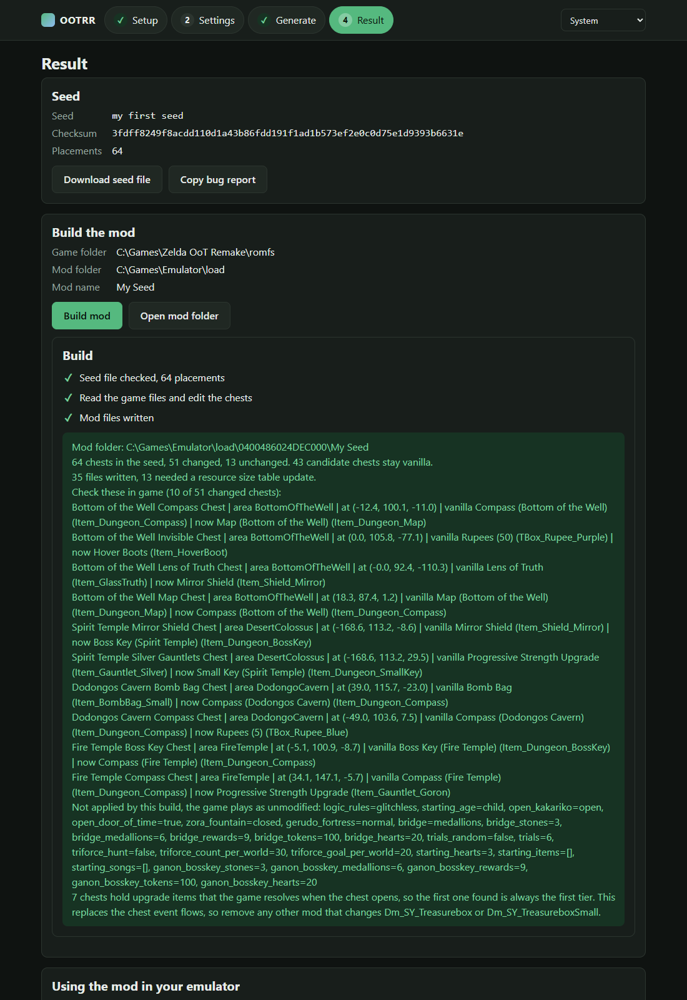

The report lists the chests that changed. The line starting with "Mod folder" is where your mod was written. If you build again with the same mod name, the old version is replaced.

The page also shows a short list for Lichii. You can now close the browser tab. Close the black window later.

## 7. Turn the mod on in Lichii

1. Open Lichii. Your game is in the list.

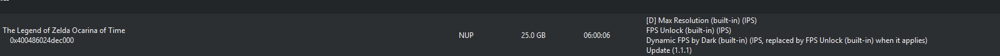

2. Right click the game and choose **Configure Game**. In the same menu, **Open Mod Data Location** opens the mod folder from section 3.

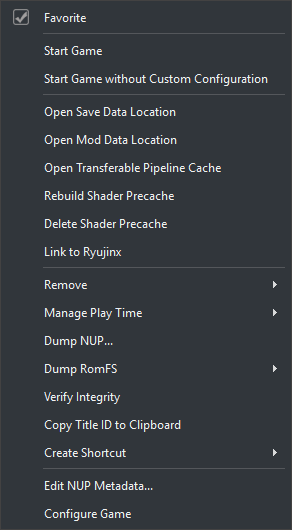

3. On the **Add-Ons** tab you will see the mod you built. Tick it, then click **OK**.

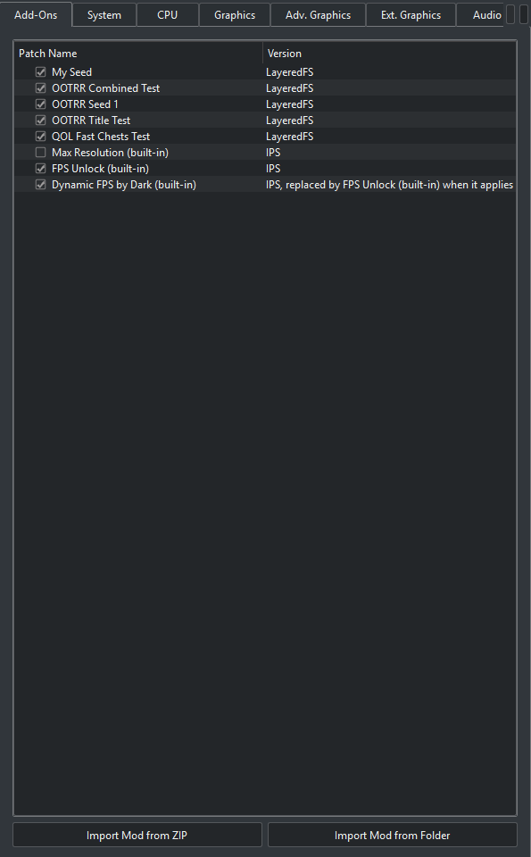

In this screenshot several test mods are ticked. Untick any other mod that edits chests or item pickup scenes. Two chest mods at once do not work together. Note too that this randomizer replaces the chest opening flows, so a "faster chests" mod must be off.

4. Start the game and choose **New Game**. Use a new save slot, not your real save. A save that already opened chests will not show the new items in those chests, and an old save can get confused. Back up your saves if you are unsure.

## 8. Playing

- Open chests as usual. The item you get is the one from the spoiler.
- Dungeon keys, maps and compasses stay in their own dungeon.
- Progressive items such as the Hookshot and the bomb bags come in order, so the first one you find is always the first tier.
- The seed can always be finished according to the logic, but the logic is based on the original game with the remake's differences added one by one. If you find a place where the game needs something the seed did not give you, please report it.

## Trying another seed

Go back to the **Generate** step, make a new seed and build it with the same mod name. The old mod is replaced. Start another new game.

To remove the mod, untick it in the Add-Ons tab, or delete the folder `<mod folder>\0400486024DEC000\<mod name>`.

## Updating OOTRR

Download the newest setup file and run it, it installs over the old version. If the page ever stays on "Loading" forever you have version 0.2.0, update to 0.2.1 or newer.

## Running it without the installer

Unpack the zip anywhere. Double click `ootrr.exe` (versions newer than 0.2.1 start the page right away). On older versions open a terminal in that folder and run `ootrr.exe serve`, then open the link it prints.

## Troubleshooting

- **Nothing happens when I run ootrr.exe.** Start OOTRR from the Start menu, or run `ootrr.exe serve` in a terminal. Older versions printed a list of commands and closed the window when started by double clicking.
- **The page says Loading forever.** You have version 0.2.0. Install 0.2.1 or newer.
- **Setup says the 1.1.1 files are missing.** The game folder is the base game without the update. Extract again with the update applied.
- **"Game folder does not exist" or the folder is not accepted.** Pick the folder that directly contains `Pack`, `Banc`, `Event` and `System`. One level too high fails.
- **My path has quotes around it.** That is fine, OOTRR removes one pair of quotes.
- **Windows SmartScreen or my antivirus warns.** The installers are not signed. The files are built by GitHub from the public source, and `SHA256SUMS.txt` lets you check your download. You can also upload the file to virustotal.com yourself.
- **The mod does nothing in the game.** Check it is ticked in the Add-Ons tab, that you started a new game, and that no other mod edits chests.
- **A preset is greyed out.** Not available in this build yet.
- **Something broke, a softlock, a missing item, a crash.** Use **Copy bug report** on the Generate or Result page, then post it with what you did, what you expected and what happened in the bug reports forum on the OOTRR Discord. A screenshot or short clip helps a lot.

## Privacy

OOTRR runs on your own computer. The page only talks to your computer. The only network use is an optional check for new versions, which you can switch off with `ootrr serve --no-update-check`, or with "Stop checking" on the banner.
